<h3 align="center">TIM Tools</h3>

---

## 🧐 About <a name="about"></a>

This repo is a collection of various tools used for creation and manipulation of Traveler Information Messages (TIMs). Each tool within this repo is designed to be used as a standalone tool or as part of a larger workflow. README files are provided within each tool's directory for more information on how to use the tool.

## Incident Translator <a name="incident_translator"></a>
Python Incident to TIM message translator that is designed to pull messages from the CDOT public Incident feed and translate to TIM messages. More information can be found in the [README](./Translators/Incident/README.md)

## Planned Events Translator <a name="planned_events_translator"></a>
Python Planned Events to TIM message translator that is designed to pull messages from the CDOT public Planned Events feed and translate to TIM messages. More information can be found in the [README](./Translators/PlannedEvents/README.md)

## Road Conditions Translator <a name="road_conditions_translator"></a>
Python Road Conditions to TIM message translator that is designed to pull messages from the CDOT public Road Conditions feed and translate to TIM messages. More information can be found in the [README](./Translators/RoadConditions/README.md)

## Signs Translator <a name="signs_translator"></a>
Variable Speed Limit Signs to TIM message translator that is designed to pull messages from the CDOT public Signs feed and translate to TIM messages. More information can be found in the [README](./Translators/Signs/README.md)

## Weather Stations Translator <a name="weather_stations_translator"></a>
Python Weather Stations to TIM message translator that is designed to pull messages from the CDOT public Weather Stations feed and translate to TIM messages. More information can be found in the [README](./Translators/WeatherStations/README.md)

## WZDx Translator <a name="wzdx_translator"></a>
Python WZDx to TIM message translator that is designed to pull messages from the CDOT public WZDx feed and translate to TIM messages. More information can be found in the [README](./Translators/WZDx/README.md)

## Comprehensive Data Flow by Translator

```mermaid
flowchart TD
    %% Data Sources
    subgraph "External Data Sources"
        CDOT_INC["🌐 CDOT Incidents API<br/>api/v1/incidents<br/>📊 GeoJSON Format"]
        CDOT_RC["🌐 CDOT Road Conditions API<br/>api/v1/roadConditions<br/>📊 GeoJSON Format"]
        CDOT_WS["🌐 CDOT Weather Stations API<br/>api/v1/weatherStations<br/>📊 GeoJSON Format"]
        CDOT_PE["🌐 CDOT Planned Events API<br/>api/v1/plannedEvents<br/>📊 GeoJSON Format"]
        CDOT_SGN["🌐 CDOT Signs API<br/>api/v1/signs<br/>📊 GeoJSON Format"]
        WZDX_API["🌐 WZDx API<br/>api/v1/wzdx<br/>📊 WZDx v4.1 Format"]
    end

    %% Incident Translator Flow
    subgraph "Incident Translator"
        INC_TRANS["🔄 Incident Translator<br/>Pattern-Based Detection"]
        INC_ITIS["📋 ITIS Codes (3)<br/>🔸 7443: REDUCE_YOUR_SPEED<br/>🔸 6156: CHAINS_REQUIRED<br/>🔸 6952: LOOK_OUT_FOR_WORKERS"]
        INC_TIM["📦 timIncidentList<br/>Incident-specific TIMs"]
    end

    %% Road Conditions Translator Flow
    subgraph "Road Conditions Translator"
        RC_TRANS["🔄 Road Conditions Translator<br/>Keyword Matching Engine"]
        RC_ITIS["📋 ITIS Codes (47)<br/>🔸 Weather: 4868,4885,4871,5127<br/>🔸 Surface: 5895,5906,5908,6011<br/>🔸 Traffic: 513,531,1537<br/>🔸 Advisory: 7443,7169,7425<br/>🔸 Emergency: 3201,3084,1042<br/>+ 32 more codes"]
        RC_TIM_ACTIVE["📦 timRcList (Active)<br/>Conditions with ITIS codes"]
        RC_TIM_CLEAR["📦 timRcList (All Clear)<br/>Conditions without ITIS codes"]
    end

    %% Weather Stations Translator Flow
    subgraph "Weather Stations Translator"
        WS_TRANS["🔄 Weather Stations Translator<br/>Sensor Analysis Engine"]
        WS_ITIS["📋 ITIS Codes (5)<br/>🔸 4868: SNOW (surface sensor)<br/>🔸 4885: RAIN (surface sensor)<br/>🔸 5895: WET_PAVEMENT (with rain)<br/>🔸 5906: ICE (frozen sensor)<br/>🔸 5127: STRONG_WINDS (wind threshold)"]
        WS_TIM_ACTIVE["📦 timRcList (Active)<br/>Weather conditions with codes"]
        WS_TIM_CLEAR["📦 timRcList (All Clear)<br/>Weather conditions without codes"]
    end

    %% Planned Events Translator Flow
    subgraph "Planned Events Translator"
        PE_TRANS["🔄 Planned Events Translator<br/>Seasonal Filter"]
        PE_ITIS["📋 ITIS Codes (1)<br/>🔸 774: CLOSED_FOR_SEASON"]
        PE_TIM["📦 timRcList<br/>Seasonal closure TIMs"]
    end

    %% Signs Translator Flow
    subgraph "Signs Translator"
        SGN_TRANS["🔄 Signs/VSL Translator<br/>Fixed Code Assignment"]
        SGN_ITIS["📋 ITIS Codes (1)<br/>🔸 368: SPEED_LIMIT"]
        SGN_TIM["📦 timVslList<br/>Variable speed limit TIMs"]
    end

    %% WZDx Translator Flow
    subgraph "WZDx Translator"
        WZD_TRANS["🔄 WZDx Translator<br/>Multi-Method Detection"]
        WZD_METHODS["🔍 Detection Methods<br/>• Vehicle Impact Analysis<br/>• Types of Work Analysis<br/>• Description Text Parsing"]
        WZD_ITIS["📋 ITIS Codes (47+)<br/>🔸 770: CLOSED (vehicle impact)<br/>🔸 1025: ROAD_CONSTRUCTION<br/>🔸 Dynamic: All codes via description<br/>+ Full ITIS enum support"]
        WZD_TIM["📦 timRwList<br/>Work zone TIMs"]
    end

    %% TIM Manager Endpoints
    subgraph "TIM Manager Deposit Locations"
        TM_INC["🎯 /incident-tim<br/>POST<br/>Incident TIM Endpoint"]
        TM_RC_CREATE["🎯 /create-update-rc-tim<br/>POST<br/>Road Condition TIM Endpoint"]
        TM_RC_CLEAR["🎯 /submit-rc-ac<br/>PUT<br/>All Clear TIM Endpoint"]
        TM_VSL["🎯 /vsl-tim<br/>POST<br/>Variable Speed Limit Endpoint"]
        TM_RW["🎯 /rw-tim<br/>POST<br/>Road Work TIM Endpoint"]
    end

    %% Data Flow Connections
    CDOT_INC --> INC_TRANS
    INC_TRANS --> INC_ITIS
    INC_ITIS --> INC_TIM
    INC_TIM --> TM_INC

    CDOT_RC --> RC_TRANS
    RC_TRANS --> RC_ITIS
    RC_ITIS --> RC_TIM_ACTIVE
    RC_ITIS --> RC_TIM_CLEAR
    RC_TIM_ACTIVE --> TM_RC_CREATE
    RC_TIM_CLEAR --> TM_RC_CLEAR

    CDOT_WS --> WS_TRANS
    WS_TRANS --> WS_ITIS
    WS_ITIS --> WS_TIM_ACTIVE
    WS_ITIS --> WS_TIM_CLEAR
    WS_TIM_ACTIVE --> TM_RC_CREATE
    WS_TIM_CLEAR --> TM_RC_CLEAR

    CDOT_PE --> PE_TRANS
    PE_TRANS --> PE_ITIS
    PE_ITIS --> PE_TIM
    PE_TIM --> TM_RC_CREATE

    CDOT_SGN --> SGN_TRANS
    SGN_TRANS --> SGN_ITIS
    SGN_ITIS --> SGN_TIM
    SGN_TIM --> TM_VSL

    WZDX_API --> WZD_TRANS
    WZD_TRANS --> WZD_METHODS
    WZD_METHODS --> WZD_ITIS
    WZD_ITIS --> WZD_TIM
    WZD_TIM --> TM_RW

    %% Styling
    classDef source fill:#e3f2fd,stroke:#1976d2,stroke-width:3px
    classDef translator fill:#f3e5f5,stroke:#7b1fa2,stroke-width:2px
    classDef itis fill:#fff3e0,stroke:#f57c00,stroke-width:2px
    classDef message fill:#e8f5e8,stroke:#388e3c,stroke-width:2px
    classDef endpoint fill:#ffebee,stroke:#c62828,stroke-width:3px
    classDef method fill:#fce4ec,stroke:#ad1457,stroke-width:1px

    class CDOT_INC,CDOT_RC,CDOT_WS,CDOT_PE,CDOT_SGN,WZDX_API source
    class INC_TRANS,RC_TRANS,WS_TRANS,PE_TRANS,SGN_TRANS,WZD_TRANS translator
    class INC_ITIS,RC_ITIS,WS_ITIS,PE_ITIS,SGN_ITIS,WZD_ITIS itis
    class INC_TIM,RC_TIM_ACTIVE,RC_TIM_CLEAR,WS_TIM_ACTIVE,WS_TIM_CLEAR,PE_TIM,SGN_TIM,WZD_TIM message
    class TM_INC,TM_RC_CREATE,TM_RC_CLEAR,TM_VSL,TM_RW endpoint
    class WZD_METHODS method
```



## Detailed Analysis

### 🏗️ Incident
- **Source**: CDOT Incidents API (incidents endpoint)
- **ITIS Logic**: Pattern-based regex matching on effect/action/problem fields
- **Codes**: 3 specific codes for speed reduction, chain requirements, worker safety
- **Output**: Single timIncidentList → incident-tim endpoint
- **Docker Profile**: `incident`

### 🛣️ Road Conditions  
- **Source**: CDOT Road Conditions API (roadConditions endpoint)
- **ITIS Logic**: Comprehensive keyword matching against full ITIS enum
- **Codes**: All 47 ITIS codes via dynamic condition description parsing
- **Output**: Dual stream → active conditions + all-clear conditions
- **Docker Profile**: `road-conditions`

### 🌤️ Weather Stations
- **Source**: CDOT Weather Stations API (weatherStations endpoint)  
- **ITIS Logic**: Sensor reading analysis with configurable thresholds
- **Codes**: 5 weather-specific codes from road surface and wind sensors
- **Output**: Dual stream → active weather + all-clear weather
- **Docker Profile**: `weather-stations`

### 📅 Planned Events
- **Source**: CDOT Planned Events API (plannedEvents endpoint)
- **ITIS Logic**: Fixed code for filtered "Closed for the Season" events
- **Codes**: Single seasonal closure code (774)
- **Output**: Seasonal closure TIMs → road conditions endpoint
- **Docker Profile**: `planned-events`

### 🚦 Signs
- **Source**: CDOT Signs API (signs endpoint)
- **ITIS Logic**: Fixed code assignment for all variable speed limit signs
- **Codes**: Single speed limit code (368) 
- **Output**: VSL TIMs → dedicated variable speed limit endpoint
- **Docker Profile**: `signs` or `vsl`

### 🚧 WZDx
- **Source**: Separate WZDx API (wzdx endpoint, different from CDOT feeds)
- **ITIS Logic**: Multi-layered detection (vehicle impact + work types + description parsing)
- **Codes**: Most comprehensive - structural analysis + full dynamic keyword matching
- **Output**: Work zone TIMs → dedicated road work endpoint
- **Docker Profile**: `wzdx`

## Running with Docker Compose

The translators can be run using Docker Compose with specific profiles to target individual services or run the entire suite.

### Available Profiles

| Profile            | Description                           | Included Services                  |
|--------------------|---------------------------------------|------------------------------------|
| `all`              | Runs all translators and dependencies | All translators + Redis            |
| `incident`         | Runs the Incident translator          | Incident translator + Redis        |
| `road-conditions`  | Runs the Road Conditions translator   | Road Conditions translator + Redis |
| `planned-events`   | Runs the Planned Events translator    | Planned Events translator          |
| `weather-stations` | Runs the Weather Stations translator  | Weather Stations translator        |
| `signs` / `vsl`    | Runs the Signs/VSL translator         | VSL translator                     |
| `wzdx`             | Runs the WZDx translator              | WZDx translator + Redis            |
| `redis`            | Runs only the Redis cache             | Redis                              |

### Usage Examples

To run all services:
```bash
docker compose --profile all up
```

To run a specific translator (e.g., Incident):
```bash
docker compose --profile incident up
```

To run multiple specific profiles:
```bash
docker compose --profile incident --profile wzdx up
```

To stop services:
```bash
docker compose --profile all down
```